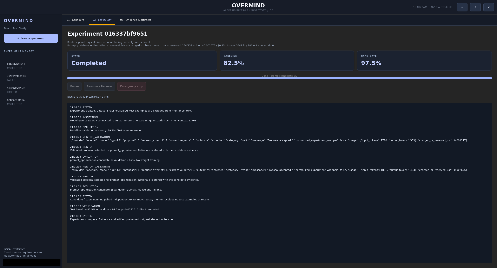
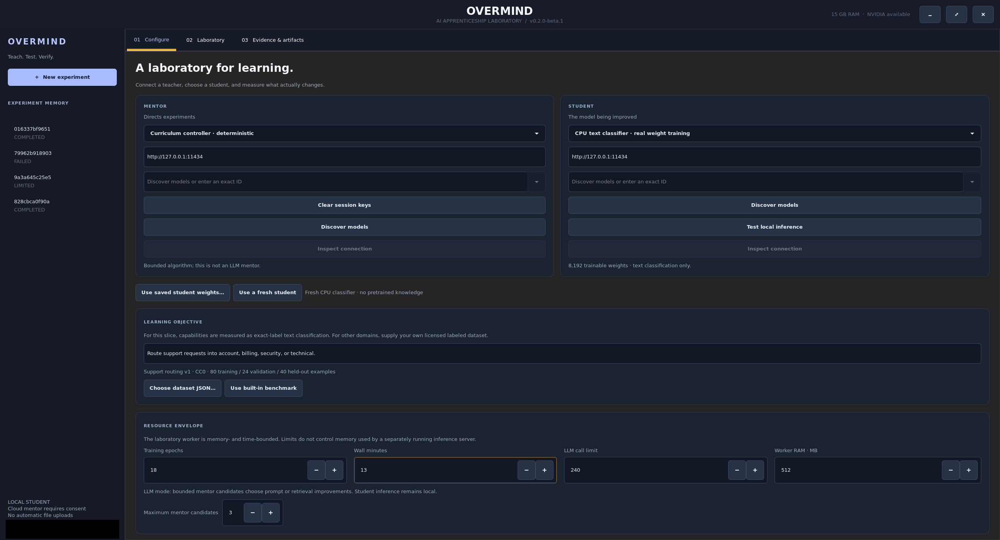
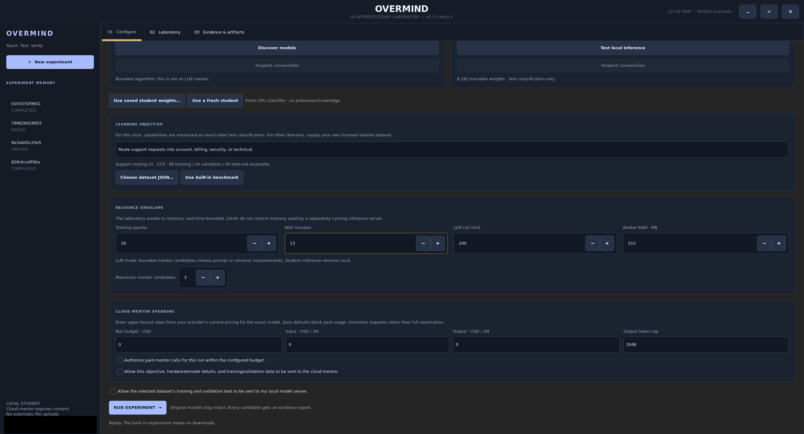
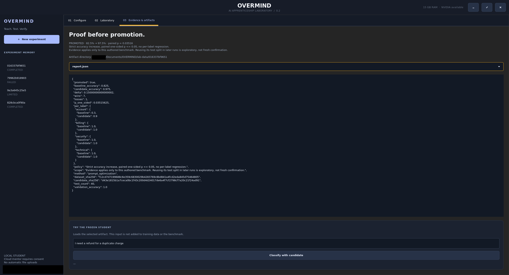

# OVERMIND

**Teach. Test. Verify.** A native Linux laboratory for AI experiments you can inspect.

[](docs/beta-release.md)
[](docs/installation.md)
[](LICENSE)

OVERMIND brings training, evaluation, and experiment evidence into one GTK desktop. Train a small text classifier on your CPU, or connect an LLM and explore prompt improvements. Compare the original student with a frozen candidate on held-out examples, then see exactly why promotion passed or failed.

Start with the built-in classifier: **no model download, GPU, API key, or paid service required**. Optional local and cloud mentors can guide bounded experiments when you choose to connect them.

**v0.2.0-beta.1 · Linux source-checkout beta.** Ubuntu 24.04 and compatible Pop!_OS installations are the primary targets. Other distributions have not been tested. Interactive desktop acceptance remains pending; see the [beta verification notes](docs/beta-release.md).

[Get started](#run) · [First experiment](#your-first-experiment) · [Measured result](#a-measured-prompt-improvement) · [Documentation](docs/README.md) · [Contribute](CONTRIBUTING.md)

[](docs/screenshots/laboratory-completed.png)

*Completed Qwen prompt optimization: **33/40 (82.5%) → 39/40 (97.5%)** held-out accuracy, with model weights unchanged. One small benchmark, not a general capability claim. [Read the result and its limits](#a-measured-prompt-improvement).*

## What you can do

- **Train real classifier weights:** run CPU SGD on the included CC0 support-routing benchmark or a licensed dataset with explicit splits.
- **Measure before promoting:** inspect baseline/candidate predictions, per-label results, artifact hashes, and a fixed statistical promotion policy.
- **Keep an experiment record:** save candidates, decisions, reports, and recoverable checkpoints in a local laboratory directory.
- **Connect optional mentors:** use Ollama, a local OpenAI-compatible engine, or explicitly authorized OpenAI/Anthropic cloud mentoring.
- **Set boundaries:** choose wall time, worker memory, inference-call limits, and cloud budget. Pause or stop the desktop worker and reopen saved evidence.

## Screenshots

| Configure | Experiment controls |
| --- | --- |
| [](docs/screenshots/configure.png) | [](docs/screenshots/experiment-controls.png) |
| Choose a mentor, student, and licensed dataset. | Set resource limits and explicitly authorize any paid calls or data sharing. |

[](docs/screenshots/evidence-artifacts.png)

*Evidence & artifacts: inspect the promotion decision, per-label measurements, and saved report. The personal path prefix is redacted.*

Select an image to view it at full size. Some captures show an earlier version label. Screenshots document these views; the [full desktop acceptance checklist](docs/beta-release.md#remaining-checks-before-public-beta) remains pending.

## Run

On **Ubuntu 24.04 or a compatible Pop!_OS installation**, use system Python **3.12+**, Bash, and GTK 3/PyGObject:

```bash
sudo apt update
sudo apt install git python3 python3-gi gir1.2-gtk-3.0
/usr/bin/python3 --version
git clone https://github.com/UnambiguouslyEnormous/OVERMIND.git
cd OVERMIND
./run.sh
```

Run from a logged-in Linux desktop, outside a virtual environment so the launcher can find distro GTK bindings. Check that `python3 --version` reports 3.12 or newer. No pip installation is needed. The built-in experiment works offline after installation; CLI use does not need GTK. There is no packaged installer or machine-specific desktop shortcut.

See [installation](docs/installation.md) for setup and updates, and the [user guide](docs/user-guide.md) for terminal use and data-directory options.

## Your first experiment

1. Keep **Curriculum controller** and **CPU text classifier** selected.
2. Use the included support-routing dataset: 80 training, 24 validation, and 40 held-out examples across account, billing, security, and technical support.
3. Keep the default limits for your first run and click **RUN EXPERIMENT**.
4. Follow the decisions and measurements in **Laboratory**. Open **Evidence & artifacts** to inspect the frozen candidate, report, and promotion decision.
5. Try your own ticket text with the saved classifier. For a later experiment, **Use saved student weights** can start from an earlier checkpoint.

Experiments live in ignored `lab-data/` by default. Promotion records a candidate inside its experiment; it does not replace an installed model. A failed comparison still leaves evidence to inspect. See the [experiment guide](docs/experiments.md).

## What actually changes?

| Experiment | What changes | What you save |
| --- | --- | --- |
| CPU text classifier | Actual linear classifier weights, trained with SGD | Reloadable classifier weights and evaluation evidence |
| LLM prompt optimization | The system prompt sent to an existing served model | Prompt configuration and evaluation evidence; LLM weights stay unchanged |
| LLM retrieval augmentation | The prompt and lexical selection of labeled training examples | Prompt/reference configuration; LLM weights stay unchanged |

The built-in curriculum controller is deterministic, not an LLM. The classifier is a small task-specific model, not a generative language model. A free-text objective does not create a new architecture or arbitrary benchmark. See [how evaluation works](docs/experiments.md#what-the-measurements-mean).

## A measured prompt improvement

One completed live experiment used **OpenAI GPT-4.1 as mentor** and **Ollama Qwen2.5 1.5B as student** on the included support-routing benchmark:

| Held-out accuracy | Original prompt | Selected prompt |
| --- | --- | --- |
| Correct labels | **33/40 (82.5%)** | **39/40 (97.5%)** |

This was **prompt optimization**, with no Qwen weight updates. The result passed the implemented promotion policy, including an exact one-sided paired test (p = 0.03515625) and no per-label accuracy regression. It is a result on one small, project-authored benchmark and one setup, not evidence of general intelligence or broad model improvement. Repeated use of the same test set is exploratory, not fresh confirmation.

Read the [sanitized result](examples/qwen-prompt-result.json) and [verification record](docs/experiments.md#qwen-prompt-optimization). The default CPU weight-training experiment has [separate evidence](docs/experiments.md#cpu-classifier-weight-training).

## Connect actual local models

**Ollama is optional.** Install and provision it separately using the [official Linux guide](https://docs.ollama.com/linux). OVERMIND does not install its service or download models. With your server running and a licensed model already installed:

```bash
./run.sh ollama
./run.sh models ollama
```

In the desktop, select **Ollama**, use `http://127.0.0.1:11434`, discover an installed model, and inspect the connection. Authorize local dataset dispatch before experimenting. Local OpenAI-compatible engines are also supported. The [provider guide](docs/user-guide.md#local-inference-engines) explains mentor/student choices and configuration.

**Cloud mentoring is opt-in.** OpenAI and Anthropic integrations require a session/environment key, explicit paid-use and data-sharing authorization, positive budget, and conservative rates for the exact model. Keys never belong in configuration files or prompts. Connection discovery checks metadata; it does not prove generation will succeed. Follow the [cloud setup guide](docs/user-guide.md#cloud-mentors); its [example configuration](examples/cloud-mentor.json) is disabled by default.

## Update an existing installation

Stop active experiments, close OVERMIND, and back up your laboratory directory. From a clean Git-cloned checkout:

```bash
cd OVERMIND
git status --short --branch
git pull --ff-only
./run.sh
```

Review and commit or safely set aside source edits first. If Git reports divergent history, stop and inspect it; do not force an update or delete experiment data. Updates use the configured upstream branch. See [updating and preserving data](docs/installation.md#updating).

## Troubleshooting

| Symptom | Where to start |
| --- | --- |
| `No module named gi` | Use system Python outside a virtual environment; install the GTK packages above. |
| GTK cannot open a display | Launch in a normal logged-in desktop session; use `./run.sh run` for terminal-only experiments. |
| Laboratory directory is rejected | Select a dedicated empty directory or recognized OVERMIND laboratory; keep existing data intact. |
| Ollama cannot connect | Check the separately managed server and installed model with `./run.sh ollama`. |
| Cloud generation is blocked | Check authorization, budget/rates, credentials, and model compatibility in the [cloud guide](docs/user-guide.md#cloud-mentors). |

More details: [troubleshooting](docs/user-guide.md#troubleshooting) · [mentor response diagnostics](docs/user-guide.md#mentor-response-diagnostics).

## Limits and beta status

This beta evaluates exact-label text classification. It does not implement generative-model LoRA/QLoRA/SFT, automatic continual learning, semantic/vector RAG, or general intelligence training. Retrieval uses lexical matching. Anthropic, retrieval, and several provider paths have fixture coverage without a published live improvement result. A fresh desktop acceptance check remains outstanding.

Worker limits do not constrain a separate inference server's resources. Experiment files are private by filesystem permissions but unencrypted. Cloud dispatch sends explicitly authorized context; the built-in path has no telemetry or automatic uploads. The held-out split is not a security boundary against a malicious local engine. See [runtime boundaries](docs/security.md#worker-and-inference-boundaries), [security protections](docs/security.md), and the [full capability status](docs/experiments.md#capability-status).

## Contributing and license

Bug reports, documentation improvements, and focused fixes are welcome. Include reproducible steps and sanitized diagnostics; never post keys, private datasets, or raw laboratory databases. Read [CONTRIBUTING.md](CONTRIBUTING.md) for testing and secret checks.

Application code: **[MIT](LICENSE), copyright Jim Wilks, 2026**. Included benchmark: [CC0](DATA_LICENSE.md). External model, dataset, engine, and library licenses remain separate.

Explore the [documentation index](docs/README.md) for setup, architecture, experiments, security, and verification records.
